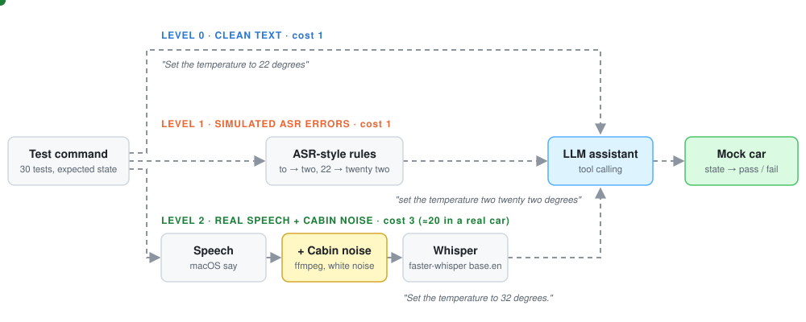

# Multi-fidelity evaluation of an in-car voice assistant

How many bugs does a cheap text test miss, and when is an expensive audio test worth its cost?
This project tests an LLM car assistant at three levels of realism, records 270 runs, and replays
them to compare testing strategies under a fixed budget.



## At a glance

| | |
|---|---|
| **System under test** | LLM assistant with tool calling (`set_temperature`, `navigate_to`, `set_volume`) on a mock car |
| **Levels** | 0 clean text · 1 simulated ASR errors · 2 real speech (macOS `say`) + cabin noise + Whisper |
| **Experiment** | 30 tests × 3 levels × 3 runs = 270 runs, all in [`results.csv`](results.csv) |
| **Pass rate** | Level 0 **97 %** · Level 1 **81 %** · Level 2 **47 %** |
| **Main finding** | Cheap screening pays off only when audio tests are expensive and the budget is small, and only if the cheap level's failures predict real ones |

## Results: which strategy finds the most bugs?



A "real bug" is a test that fails at least once at level 2 (20 of 30 tests). Each strategy is replayed
300 times on the recorded outcomes ([`simulate.py`](simulate.py)), so the curves cost no API calls.

| Strategy | Level 2 = 3× · budget 30 | budget 90 | Level 2 = 20× · budget 100 | budget 400 |
|---|---|---|---|---|
| A · only level 2 | **5.4** | **16.1** | 2.7 | 10.7 |
| B · only level 0 | 1.0 | 1.0 | 1.0 | 1.0 |
| C · level 0 first, then level 2 | 1.0 | 11.3 | 2.6 | 10.4 |
| D · level 1 first, suspects to level 2 first | 4.7 | 12.9 | **6.0** | **12.2** |

- **Text-only testing is blind.** Strategy B finds one bug however much it spends. Level 0 passes 87 of 90 runs.
- **If audio tests are cheap, test everything at level 2.** Screening spends budget that finds nothing new.
- **If audio tests are expensive, screen with level 1.** At a 20× cost ratio and a budget of 100, D finds 2.2× more bugs than A, because tests that break under simulated ASR errors tend to break under real audio too. The gap closes as the budget grows.
- **A cheap level helps only if it correlates with real failures.** Level 0 almost never fails, so screening with it (C) is pure cost.

## What the levels revealed

| Kind | Example | Found at |
|---|---|---|
| Assistant bug | "Set the volume to 12" never changes the volume (the tool would clamp it to 10, but the model refuses to call it) | every level, so level 0 is enough |
| False alarm | "navigate two munik central station" fails at level 1, but Whisper hears the real audio correctly | level 1 only |
| Silent wrong action | "28 degrees" heard as "78 degrees"; the model converts Fahrenheit and sets **25.6 °C** without a word | level 2 only |
| Wrong destination | Regensburg → "Raven's place", Augsburg → "Oxford", Marienplatz → "Mary's office" | level 2 only |
| Hallucinated speech | "Take me to Frankfurt Airport" → "Thank you for your support." | level 2 only |

## How it works

| File | Role |
|---|---|
| [`car/state.py`](car/state.py) | Mock car state and the three tools (temperature 16–28 °C is refused outside the range, volume is clamped to 0–10) |
| [`car/agent.py`](car/agent.py) | Tool-calling loop with an LLM on NVIDIA NIM (`nemotron-3.5-lightning`), max 4 steps |
| [`level0_tests.py`](level0_tests.py) | 30 commands with the expected car state: values, boundaries, refusals, off-topic, two requests in one |
| [`level1_noise.py`](level1_noise.py) | Rule-based ASR-style errors: lowercase, numbers as words, sound-alike swaps |
| [`level2_audio.py`](level2_audio.py) | Text → speech → white noise → Whisper transcript |
| [`experiment.py`](experiment.py) | Runs everything, retries on API rate limits, resumes from `results.csv` |
| [`simulate.py`](simulate.py), [`make_chart.py`](make_chart.py) | Budget strategies and the chart |

## Run it

macOS (uses `say`), Python 3.11, `ffmpeg`, and a free NVIDIA API key from [build.nvidia.com](https://build.nvidia.com).

```bash
python3.11 -m venv .venv && source .venv/bin/activate
pip install -r requirements.txt
cp .env.example .env                  # add NVIDIA_API_KEY

python run_level0.py                  # 30 clean-text tests, about 1 minute
python experiment.py                  # all 270 runs, about 20 minutes
python simulate.py                    # strategy table, instant
python make_chart.py                  # redraws docs/strategies.svg
```

If the Whisper model download hangs, prefix the command with `HF_HUB_DISABLE_XET=1`.

## Limitations

- **The noise is harsh.** White noise at amplitude 0.6 is probably worse than a real cabin with a beamforming microphone, so the level 2 pass rate is pessimistic.
- **"Real bug" is defined by level 2 itself.** This favours strategy A; a real-car ground truth would be fairer.
- **Small test set.** 30 tests and 3 runs each; one test moves a strategy's curve visibly.
- **One synthetic voice.** All audio uses the macOS voice Samantha; accents and real speakers are untested.
- **Exact-state checks.** A test passes only if the car ends in the expected state, which can also pass for the wrong reason (an off-topic command that is ignored).
